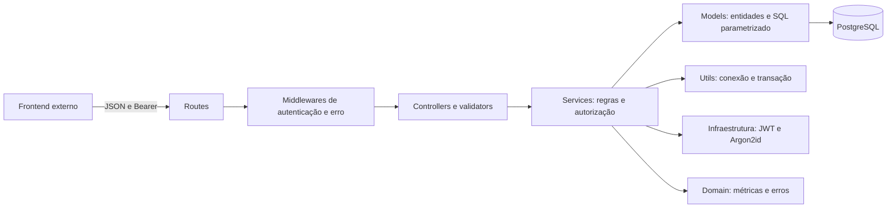

# Arquitetura MVC da API FHDOD

Atualizado em 26/11/2026. A refatoração mantém Node.js, TypeScript, Fastify e PostgreSQL, as 25 operações HTTP e os formatos JSON existentes. Este repositório é o backend; a apresentação pertence ao frontend externo, que ficou fora das alterações por decisão do usuário.

## Responsabilidades e fluxo

| Diretório | Responsabilidade |
|---|---|
| `src/config/` | Ambiente validado, pool/timeouts, CA TLS e OpenAPI |
| `src/routes/` | Métodos, caminhos, preHandlers e limites por recurso; prefixo central `/api/v1` |
| `src/controllers/` | Interpreta HTTP, aplica schemas Zod, chama serviços e define status |
| `src/validators/` | Contratos de entrada e tipos inferidos; schemas reutilizados no OpenAPI |
| `src/middlewares/` | Verificação bearer, bloqueio por senha provisória e respostas de erro |
| `src/services/` | Regras de negócio, autorização por papel/setor e delimitação de transações |
| `src/models/` | Entidades/tipos de leitura e consultas parametrizadas por recurso |
| `src/utils/database.ts` | Aquisição/liberação de clientes e BEGIN/COMMIT/ROLLBACK |
| `src/domain/` | Cálculos puros de NPS, média, satisfação e turno; erros da aplicação |
| `src/infrastructure/auth.ts` | JWT HS256, Argon2id e hash SHA-256 de tokens |
| `src/scripts/` | Provisionamento administrativo e executor de migrations |
| `tests/` | Testes HTTP, integração SQL e unidades |

`src/app.ts` apenas compõe o Fastify, plugins, middlewares e rotas. Controllers não executam SQL. Services não conhecem request/reply. Models recebem valores tipados e um cliente opcional, permitindo que operações compostas compartilhem a mesma conexão. Scripts operacionais de migration e bootstrap não são endpoints.

A camada View é externa: a API serializa JSON para o frontend. Nenhuma pasta frontend artificial ou mudança visual foi introduzida. A raiz foi mantida para preservar os comandos do Render.

## Fluxos preservados

- **Login:** e-mail normalizado, perfil ativo, comparação Argon2id, emissão de access/refresh JWT e persistência apenas do hash do refresh.
- **Autenticação:** a assinatura valida HS256, expiração e claims obrigatórios. O backend consulta o perfil ativo a cada acesso protegido para usar papel e exigência de troca atuais. Claims antigos não mantêm privilégios removidos.
- **Refresh:** a sessão é bloqueada e conferida por JTI/hash, revogada e substituída numa transação. Falhas revertem a rotação.
- **Senha provisória:** acesso ao painel bloqueado; `/auth/me` e troca de senha permanecem disponíveis. Após a troca, o backend lê o novo estado sem depender de reemissão do access token.
- **Pesquisa pública:** somente setor ativo e pesquisa publicada; perguntas globais e do setor, ativas.
- **Submissão:** bloqueia a pesquisa, reserva chave idempotente por pesquisa, valida perguntas/notas/consentimento e grava resposta, avaliações, ocorrência, job e chave numa transação. Repetições retornam o mesmo ID. Falhas também removem gravações parciais.
- **Acesso:** Admin gerencia contas; Admin/Ouvidoria têm funções globais autorizadas; gestores veem agregados e gerenciam pesquisas/perguntas dos setores atribuídos. Ocorrências e relatórios individuais são restritos a Admin/Ouvidoria.

Data de atendimento permanece opcional. O turno usa `America/Sao_Paulo`: manhã [07:00,12:00), tarde [12:00,19:00), noite [19:00,07:00). Sem atendimento informado, usa-se a hora da submissão. Filtros temporais mantêm `from` inclusivo e `to` exclusivo, agora validando `from < to`.

## Erros e segurança

Os sucessos preservam listas/objetos existentes, sem novo envelope. Erros seguem `{error:{code,message,requestId}}`, incluindo 404, JSON inválido, 413, 415 e rate limit 429. Violações de unicidade retornam 409 e vínculos/checks inválidos retornam 400. Readiness mantém 503 genérico. Logs não incluem corpos ou detalhes de erro PostgreSQL que possam carregar valores pessoais; Authorization e Cookie são ocultados.

CORS usa origens explícitas, sem credenciais; Helmet, limite de corpo de 32 KiB e limites global/login/submissão permanecem ativos. Segredos ficam no ambiente, TLS PostgreSQL exige CA validada em produção e SQL usa parâmetros. Logout revoga refresh; access tokens já emitidos continuam sujeitos ao TTL e ao perfil ativo atual, sem blacklist de token.

## Limites operacionais

Não houve alteração de schema, execução de migrations em bancos existentes, importação de dados, deploy ou mudança no frontend. Os testes aplicam as migrations num PostgreSQL em memória com PGlite; rede, TLS, múltiplas conexões concorrentes e a hospedagem real ainda precisam de staging.

Métricas ainda leem notas para cálculo em memória; agregação SQL deve ser guiada por volume e medição. Rate limit usa armazenamento local do processo; múltiplas instâncias precisam de armazenamento compartilhado. A fila `notification_jobs` permanece persistida, sem worker/provedor de e-mail. Detalhes e próximos passos: [relatório](REFACTOR-REPORT.md) e [testes](TESTING.md).
