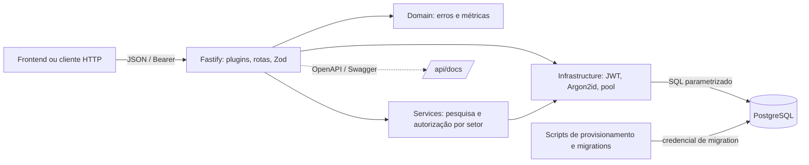
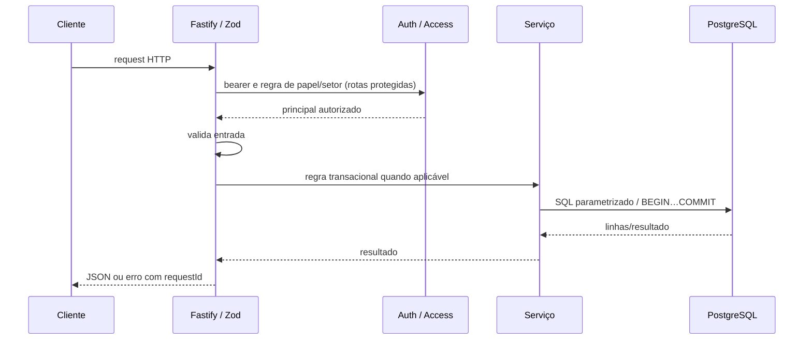

# Arquitetura do backend

**Projeto:** API FHDOD — Pesquisa de Satisfação · **Analisado em:** 25/11/2026.

## 1. Introdução e objetivo

Este documento descreve a implementação backend observada neste checkout, suas responsabilidades, fluxos, segurança e limites conhecidos. A estrutura é uma API Fastify com módulos por responsabilidade; não se afirma que siga integralmente MVC, Clean Architecture ou outro padrão formal.

## 2. Tecnologias utilizadas

| Tecnologia | Uso identificado |
|---|---|
| Node.js 22+ / TypeScript 5, modo estrito | Runtime e linguagem |
| Fastify 5 | Servidor HTTP e injeção para testes |
| PostgreSQL / `pg` | Banco relacional e pool de conexões |
| Zod | Validação de configuração, parâmetros e corpos |
| `jose` | Emissão/verificação de JWT HS256 |
| `argon2` | Hash de senha com Argon2id |
| `@fastify/cors`, `helmet`, `rate-limit` | CORS, cabeçalhos e limites HTTP |
| `@fastify/swagger`, `swagger-ui` | Especificação OpenAPI 3.1 e UI |
| Vitest, ESLint, Prettier | Testes, lint e formatação |

## 3. Visão geral

`src/server.ts` lê configuração e inicializa a aplicação construída por `src/app.ts`. O arquivo da aplicação registra plugins, documentação e handlers HTTP; valida dados com Zod; executa consultas diretamente ou delega a regras/transações em serviços. `src/domain/` concentra erros e métricas; `src/infrastructure/` configura autenticação e persistência; migrations SQL definem o schema.

O frontend não está contido no repositório; comunicação REST é inferida da API e da descrição de integração, sem inspeção do cliente.

## 4. Organização de arquivos

| Caminho | Responsabilidade comprovada |
|---|---|
| `src/server.ts` | `listen`, encerramento do servidor/pool em SIGINT/SIGTERM |
| `src/app.ts` | Plugins Fastify, schemas, OpenAPI, endpoints e tratamento de erro |
| `src/config.ts` | Leitura de ambiente, defaults e validação Zod |
| `src/domain/errors.ts` | Tipos/fábricas de erro da aplicação |
| `src/domain/metrics.ts` | Média, NPS, satisfação e classificação de turno |
| `src/services/access.ts` | Verificação de acesso de gestor ao setor |
| `src/services/survey.ts` | Leitura pública e submissão idempotente transacional |
| `src/infrastructure/auth.ts` | JWT, Argon2id e hash SHA-256 de token |
| `src/infrastructure/database.ts` | Pool `pg`, opções TLS e limites/timeouts |
| `src/infrastructure/postgres-ssl.ts` | Configuração de TLS do PostgreSQL |
| `src/scripts/migrate.ts` | Aplicação ordenada e registrada de migrations |
| `src/scripts/create-admin.ts` | Provisionamento controlado de administrador |
| `database/migrations/*.sql` | Tabelas, tipos, índices e constraints |

Não há diretório de controllers, models ou repositories dedicado. As rotas consultam o pool diretamente em vários endpoints; isso deve ser considerado ao avaliar coesão/manutenção.

## 5. Camadas e responsabilidades

- **HTTP/aplicação:** Fastify interpreta request, autentica via preHandler, valida entrada, faz parte da autorização e converte erros em resposta.
- **Serviços:** operações de pesquisa/transação e autorização reutilizável por setor.
- **Domínio:** funções puras de cálculo e tipos de erro, sem persistência.
- **Infraestrutura:** PostgreSQL, TLS, hashing e tokens.
- **Banco:** constraints asseguram unicidade, vínculos, escalas e estados.

Separação parcial é evidenciada; não se trata de arquitetura em camadas estrita, pois parte de SQL e regras permanece em `src/app.ts`.

## 6. Fluxo de requisição

1. Fastify recebe request e atribui request ID; logger mascara Authorization e Cookie.
2. Plugins aplicam Helmet, CORS e limite padrão.
3. Rotas protegidas executam autenticação bearer, checam troca obrigatória de senha e papel/setor quando pertinente.
4. Zod valida corpo, query, path e cabeçalhos; SQL usa parâmetros PostgreSQL.
5. A rota executa a consulta ou delega a service. Operações compostas usam transação.
6. Handler retorna JSON/código HTTP; o error handler converte validações, erros da aplicação e conflito único; erro inesperado é logado e retorna mensagem genérica com request ID.

## 7. Comunicação entre componentes

Clientes enviam/recebem JSON HTTP sob prefixo `/api/v1`; rotas privadas usam `Authorization: Bearer`. Tokens são retornados em JSON, sem cookie de sessão. `CORS_ORIGINS` é lista separada por vírgulas; CORS não aceita credenciais. Pool `pg` conecta a `DATABASE_URL`; script de migration usa `MIGRATION_DATABASE_URL`. Produção requer CA confiável. Nenhum SDK externo além do PostgreSQL foi identificado no runtime.

## 8. Modelagem e acesso aos dados

Tabelas: `profiles`, `sectors`, `sector_managers`, `surveys`, `questions`, `responses`, `answers`, `complaints`, `app_settings`, `submission_keys`, `notification_jobs`, `refresh_sessions` e `schema_migrations` (criada pelo executor). IDs principais são UUID; datas usam `timestamptz`. FKs usam `ON DELETE RESTRICT`, exceto refresh sessions relacionadas a perfil com cascade. Enums/checks representam papéis, estado, escalas e consentimento. Índice parcial garante uma pesquisa publicada por setor.

Não há ORM/repository. SQL é emitido com `pg`; parâmetros `$1..` reduzem risco de injeção. Nas consultas de métricas, algumas linhas são carregadas na aplicação para cálculo; avaliar agregação SQL/paginação e índices sob volume real.

## 9. Rotas HTTP

| Método | Endpoint | Acesso / finalidade |
|---|---|---|
| GET | `/api/v1/health/live` | Público; processo ativo |
| GET | `/api/v1/health/ready` | Público; disponibilidade do banco |
| POST | `/api/v1/auth/login` | Público; autenticação |
| POST | `/api/v1/auth/refresh` | Público; rotação de refresh |
| POST | `/api/v1/auth/logout` | Público; revogação de refresh |
| PATCH | `/api/v1/auth/password` | Bearer; troca de senha |
| GET | `/api/v1/auth/me` | Bearer; perfil atual |
| GET/POST | `/api/v1/users` | Admin; listar/criar usuário |
| GET | `/api/v1/sectors/public` | Público; setores com pesquisa publicada |
| GET/POST | `/api/v1/sectors` | Bearer; listar por acesso/criar (Admin/Ouvidoria) |
| GET | `/api/v1/surveys/public/:slug` | Público; pesquisa e questões |
| POST | `/api/v1/surveys/public/:slug/responses` | Público; resposta idempotente |
| POST | `/api/v1/surveys` | Bearer; publicar pesquisa |
| GET/POST | `/api/v1/questions` | Bearer; listar/criar pergunta |
| PATCH | `/api/v1/questions/:id` | Bearer; desativar pergunta |
| GET/PUT | `/api/v1/settings/notifications` | Admin/Ouvidoria; configurações |
| GET | `/api/v1/dashboard/metrics` | Bearer; métricas por escopo |
| GET | `/api/v1/tv/metrics` | Público; agregados globais |
| GET/PATCH | `/api/v1/complaints`, `/:id` | Admin/Ouvidoria; consultar/atualizar status |
| GET | `/api/v1/reports/responses` | Admin/Ouvidoria; respostas paginadas |

Referência de filtros e payloads disponível em [API.md](API.md). Prefixo OpenAPI visível em `/api/docs` e JSON em `/api/docs/json` quando o serviço está ativo. A especificação lista os endpoints e alguns contratos, mas vários handlers têm apenas descrição/respostas genéricas e não incluem schemas completos de query, body e retorno; não deve ser tratada como contrato detalhado completo.

## 10. Padrões identificados

- **Separação por módulos/responsabilidade:** domínio, serviços, infraestrutura e aplicação.
- **Injeção Fastify para teste:** `buildApp()` permite HTTP injection sem bind de porta.
- **Transação PostgreSQL:** refresh rotation e submissão de pesquisa.
- **Idempotência:** chave única por pesquisa e submissão.
- **Validação por schema:** Zod estrito em entradas selecionadas.
- **Não identificado:** padrão Repository, MVC completo, ORM ou container de injeção de dependência.

## 11. Segurança

**Implementado:** JWT HS256; access token padrão 15 minutos e refresh 30 dias; refresh associado a JTI e hash, rotacionado/revogável; Argon2id para senha; bloqueio para troca inicial; autorização por papel e associação de setor; validação Zod; SQL parametrizado; Helmet; CORS configurável; limite global/login/submissão; corpo limitado a 32 KiB; TLS PostgreSQL validado em produção; erros genéricos e logs sem headers sensíveis.

**Limites/recomendações:** rate limit depende do armazenamento/configuração padrão do plugin e não há estratégia distribuída de limiter documentada; revisar ao escalar horizontalmente. Confirmar política de retenção, privacidade/consentimento e monitoramento; usar secret manager, menor privilégio para usuários de banco e rotação de chaves. CORS não substitui controle de acesso. Confirmar validade de callbacks de senha e configuração de hospedagem em ambiente real.

Há uma divergência documental funcional: comentário de migration diz que novas respostas exigem data/hora de atendimento, enquanto validação Zod executável e OpenAPI aceitam `attendedAt` opcionalmente. O comportamento atual foi preservado; a equipe deve decidir se o requisito deve mudar.

## 12. Qualidade e manutenibilidade

- **Separação:** existe nos diretórios, porém `app.ts` ainda concentra roteamento, validações, autorização e SQL.
- **Legibilidade:** TypeScript estrito, Zod, nomes e funções por domínio; arquivo de rotas contém handlers densos, que podem ser extraídos para módulos.
- **Reutilização:** autorização de setor, autenticação e cálculos têm funções próprias; pool/configuração são centralizados.
- **Manutenção/evolução:** migrations sequenciais e scripts explícitos ajudam evolução; testes cobrem métricas e parte do HTTP.
- **SOLID/Clean Code:** princípios são referências para revisão, não uma declaração de conformidade. Single Responsibility é parcialmente atendido em módulos; não se observou abstração sistemática de repositórios ou inversão de dependência.

## 13. Escalabilidade

**Base atual:** aplicação HTTP não mantém sessão de usuário em memória; sessão refresh e dados estão no PostgreSQL; pool tem teto configurável de 1–50 conexões; consultas principais possuem índices; resposta pública é idempotente.

**Evolução possível:** separar rotas por plugin/módulo; extrair SQL repetido e operações; revisar agregações para banco, paginação e índices usando plano de consulta; adotar armazenamento compartilhado de rate limit se houver múltiplas instâncias; configurar pool total conforme limite do PostgreSQL; instrumentar latência/erros; implementar worker com fila/lease para `notification_jobs` se envio for requisito. Nenhum teste de carga ou implantação multi-instância foi identificado.

## 14. Erros e logs

Zod → 400 `VALIDATION_ERROR`; `AppError` → status/código específico; violação de unicidade PostgreSQL 23505 → 409 `CONFLICT`; falha inesperada → log de erro e 500 genérico. Erros contêm `requestId`. `/health/ready` devolve 503 sem detalhes de conexão. Não foi identificado serviço externo de logs/observabilidade nem política de retenção.

## 15. Configuração e execução

1. Node.js 22+ e PostgreSQL disponíveis.
2. Copiar `.env.example` para `.env`, definir URLs e segredos distintos com ao menos 32 caracteres.
3. Executar `npm ci` e `npm run db:migrate` em banco de desenvolvimento com credencial de migration.
4. Opcionalmente provisionar admin por `npm run admin:create` com variáveis temporárias.
5. `npm run dev` inicia por padrão em `0.0.0.0:3001`; produção compila com `npm run build` e inicia com `npm start`.

Em produção são obrigatórios `MIGRATION_DATABASE_URL` e certificado CA (via PEM ou caminho). Ver [README](../README.md) e [SECURITY.md](SECURITY.md). Migrations não devem ser aplicadas em banco de produção sem procedimento operacional apropriado.

## 16. Considerações finais

A API possui base funcional para pesquisa, autenticação, controle de acesso, relatórios e documentação online. A arquitetura está mais modular nos serviços/domínio/infraestrutura que no módulo principal de rotas. Documentação existente informa que schema legado do Supabase não está presente e não houve migração de dados. Link de Kanban, equipe/atribuições, estado público da implantação, worker de e-mail e metas operacionais precisam de confirmação.
