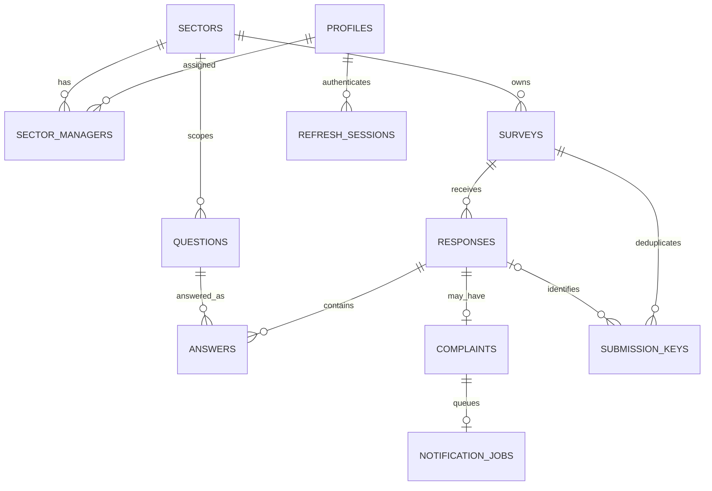

# Modelo de dados e requisitos

**Escopo:** esquema implementado nas migrations deste repositório. O frontend e eventual banco remoto não fazem parte deste checkout. Tipos e restrições abaixo refletem PostgreSQL (`database/migrations/001_initial.sql` e `002_client_confirmed_requirements.sql`); validações adicionais da API são indicadas no texto.

## 1. Introdução

O banco persiste contas e sessões, setores e pesquisas, perguntas e respostas, ocorrências, configurações de notificação e tarefas pendentes. A API usa esses dados para publicar pesquisas, registrar respostas, autenticar o painel e gerar indicadores e relatórios. O sistema depende do PostgreSQL para operações normais; o readiness verifica essa dependência.

## 2. Tecnologias e paradigma

- **SGBD/paradigma:** PostgreSQL relacional (SQL), acessado por `pg`.
- **Versão:** o código não fixa a versão do servidor. O README recomenda PostgreSQL 15 ou superior; isso é pré-requisito documentado, não verificação da instância remota.
- **Nuvem:** há referências à Aiven como destino/CA esperada em comentários e documentação, mas o checkout não comprova uma instância operacional nem seu plano. `render.yaml` configura um serviço web Render e não descreve o provisionamento do banco.
- **Migrações:** `database/migrations/001_initial.sql` e `002_client_confirmed_requirements.sql`, aplicadas em ordem lexical pelo script `src/scripts/migrate.ts`.

## 3. Justificativa técnica do paradigma

O modelo contém entidades com relações persistentes e verificáveis: perfis são associados a setores; pesquisas pertencem a setores; respostas pertencem a pesquisas; avaliações referenciam perguntas; ocorrências e tarefas referenciam respostas/ocorrências. O projeto depende de unicidade, chaves estrangeiras, checks, enums e transações para consistência (em especial na submissão idempotente). Consultas de relatórios combinam tabelas e agregam resultados. Por isso, o modelo relacional implementado atende diretamente às necessidades observadas e permite expressar essas regras no banco. Os dados de avaliação têm estrutura definida; não há evidência no código de que um modelo NoSQL seja necessário.

## 4. Entidades e atributos

Convenções: `PK` chave primária; `FK` chave estrangeira; `UNIQUE` unicidade. `NOT NULL` significa obrigatório no banco. `DEFAULT` indica valor padrão definido no DDL. UUIDs usam `gen_random_uuid()` onde indicado. `responses.attended_at` foi adicionado na migration 002 e é anulável no banco; a API aceita sua ausência e usa a hora de submissão para cálculo/filtro.

### `profiles`

| Atributo | Tipo de dado | Chave | Obrigatório | Descrição |
|---|---|---|---|---|
| id | uuid | PK | Sim | Identificador; padrão `gen_random_uuid()` |
| email | text | UNIQUE | Sim | E-mail da conta |
| full_name | varchar(150) | — | Sim | Nome de exibição |
| password_hash | text | — | Sim | Hash Argon2id criado pela aplicação |
| role | profile_role (enum) | — | Sim | `admin`, `sector_manager` ou `ombudsman` (adicionado em 002) |
| active | boolean | — | Sim | Ativa; padrão `true` |
| must_change_password | boolean | — | Sim | Exige troca; padrão `true` |
| created_at / updated_at | timestamptz | — | Sim | Instantes; padrão `now()` |

### `sectors`

| Atributo | Tipo de dado | Chave | Obrigatório | Descrição |
|---|---|---|---|---|
| id | uuid | PK | Sim | Identificador; `gen_random_uuid()` |
| name | text | — | Sim | Nome do setor |
| slug | text | UNIQUE | Sim | Identificador textual de URL |
| active | boolean | — | Sim | Ativo; padrão `true` |
| created_at | timestamptz | — | Sim | Criação; padrão `now()` |

### `sector_managers`

| Atributo | Tipo de dado | Chave | Obrigatório | Descrição |
|---|---|---|---|---|
| profile_id | uuid | PK composta, FK → profiles.id | Sim | Perfil associado; exclusão referenciada `RESTRICT` |
| sector_id | uuid | PK composta, FK → sectors.id | Sim | Setor associado; exclusão referenciada `RESTRICT` |

### `surveys`

| Atributo | Tipo de dado | Chave | Obrigatório | Descrição |
|---|---|---|---|---|
| id | uuid | PK | Sim | Identificador; `gen_random_uuid()` |
| sector_id | uuid | FK → sectors.id | Sim | Setor; `ON DELETE RESTRICT` |
| title | varchar(150) | — | Sim | Título |
| status | survey_status (enum) | — | Sim | `draft`, `published`, `archived`; padrão `draft` |
| published_at | timestamptz | — | Não | Instante de publicação |
| tablet_reset_seconds | smallint | CHECK 10–120 | Sim | Tempo de reinício; padrão 20 |
| created_at | timestamptz | — | Sim | Criação; padrão `now()` |

Além disso, índice único parcial `surveys_one_published_per_sector` permite no máximo uma pesquisa com `status='published'` por setor.

### `questions`

| Atributo | Tipo de dado | Chave | Obrigatório | Descrição |
|---|---|---|---|---|
| id | uuid | PK | Sim | Identificador; `gen_random_uuid()` |
| sector_id | uuid | FK → sectors.id | Não | Setor; nulo representa pergunta global; `ON DELETE RESTRICT` |
| text | varchar(300) | — | Sim | Enunciado |
| kind | question_kind (enum) | — | Sim | `rating` ou `nps` |
| required | boolean | — | Sim | Obrigatória; padrão `false` |
| active | boolean | — | Sim | Ativa; padrão `true` |
| position | integer | — | Sim | Ordem; padrão 0 |
| created_at | timestamptz | — | Sim | Criação; padrão `now()` |

### `responses`

| Atributo | Tipo de dado | Chave | Obrigatório | Descrição |
|---|---|---|---|---|
| id | uuid | PK | Sim | Identificador; `gen_random_uuid()` |
| survey_id | uuid | FK → surveys.id | Sim | Pesquisa; `ON DELETE RESTRICT` |
| nps | smallint | CHECK 0–10 | Sim | Nota NPS |
| shift | work_shift (enum) | Condicional | Não no DDL de 002 | `morning`, `afternoon`, `night`; inicialmente obrigatório, tornou-se anulável em 002; API calcula para novas submissões |
| created_at | timestamptz | — | Sim | Submissão; padrão `now()` |
| attended_at | timestamptz | — | Não | Data/hora informada para atendimento; adicionada em 002 |

### `answers`

| Atributo | Tipo de dado | Chave | Obrigatório | Descrição |
|---|---|---|---|---|
| id | uuid | PK | Sim | Identificador; `gen_random_uuid()` |
| response_id | uuid | FK → responses.id | Sim | Resposta; `ON DELETE RESTRICT` |
| question_id | uuid | FK → questions.id | Sim | Pergunta; `ON DELETE RESTRICT` |
| value | smallint | CHECK 1–5 | Sim | Avaliação |
| question_text | varchar(300) | — | Sim | Cópia do texto no momento do envio |
| — | — | UNIQUE composta | — | `(response_id, question_id)` impede duas respostas à mesma pergunta na resposta |

### `complaints`

| Atributo | Tipo de dado | Chave | Obrigatório | Descrição |
|---|---|---|---|---|
| id | uuid | PK | Sim | Identificador; `gen_random_uuid()` |
| response_id | uuid | FK e UNIQUE → responses.id | Sim | No máximo uma ocorrência por resposta; `ON DELETE RESTRICT` |
| comment | varchar(2000) | — | Não | Comentário |
| contact | varchar(30) | CHECK | Não | Contato; se preenchido, `contact_consent` deve ser true |
| contact_consent | boolean | — | Sim | Consentimento; padrão `false` |
| status | complaint_status (enum) | — | Sim | `open`, `in_progress`, `closed`; padrão `open` |
| created_at / updated_at | timestamptz | — | Sim | Instantes; padrão `now()` |

### `app_settings`

| Atributo | Tipo de dado | Chave | Obrigatório | Descrição |
|---|---|---|---|---|
| id | boolean | PK e CHECK (`id`) | Sim | Chave singleton, padrão `true` |
| notification_emails | text[] | — | Sim | Lista de destinatários; padrão array vazio |
| notifications_enabled | boolean | — | Sim | Habilitação; padrão `false` |
| updated_at | timestamptz | — | Sim | Atualização; padrão `now()` |

### `submission_keys`

| Atributo | Tipo de dado | Chave | Obrigatório | Descrição |
|---|---|---|---|---|
| survey_id | uuid | PK composta, FK → surveys.id | Sim | Pesquisa; `ON DELETE RESTRICT` |
| submission_id | uuid | PK composta | Sim | Chave de idempotência fornecida pelo cliente |
| response_id | uuid | FK → responses.id | Não | Resposta criada; `ON DELETE RESTRICT` |
| session_hash | char(64) | — | Sim | Hash da chave pela função `hashToken` |
| created_at | timestamptz | — | Sim | Criação; padrão `now()` |

### `notification_jobs`

| Atributo | Tipo de dado | Chave | Obrigatório | Descrição |
|---|---|---|---|---|
| id | uuid | PK | Sim | Identificador; `gen_random_uuid()` |
| complaint_id | uuid | FK e UNIQUE → complaints.id | Sim | Ocorrência associada; `ON DELETE RESTRICT` |
| attempts | integer | CHECK ≥ 0 | Sim | Tentativas; padrão 0 |
| locked_until | timestamptz | — | Não | Bloqueio temporário para processamento |
| delivered_at | timestamptz | — | Não | Entrega |
| last_error | varchar(200) | — | Não | Último erro |
| created_at / available_at | timestamptz | — | Sim | Criação e disponibilidade; padrão `now()` |

### `refresh_sessions`

| Atributo | Tipo de dado | Chave | Obrigatório | Descrição |
|---|---|---|---|---|
| jti | uuid | PK | Sim | Identificador do token |
| profile_id | uuid | FK → profiles.id | Sim | Conta; exclusão em cascata |
| token_hash | text | UNIQUE | Sim | Hash do refresh token |
| expires_at | timestamptz | — | Sim | Expiração |
| revoked_at | timestamptz | — | Não | Revogação, se houver |
| created_at | timestamptz | — | Sim | Criação; padrão `now()` |

## 5. Relacionamentos

- `profiles` N:N `sectors`, por `sector_managers` (PK composta).
- `sectors` 1:N `surveys` e 1:N `questions`; pergunta com `sector_id` nulo é global.
- `surveys` 1:N `responses`; `responses` 1:N `answers`.
- `questions` 1:N `answers`; a combinação resposta/pergunta é única.
- `responses` 0:1 `complaints`; `complaints` 0:1 `notification_jobs` (unicidade no FK).
- `surveys` 1:N `submission_keys`; cada resposta pode ser referenciada por uma chave (a coluna `response_id` não tem UNIQUE).
- `profiles` 1:N `refresh_sessions`.

## 6. Integridade

**Entidade:** PKs (UUID ou composta) identificam linhas. **Referencial:** FKs e `ON DELETE RESTRICT` preservam dados históricos; sessões usam `ON DELETE CASCADE`. **Unicidade:** e-mail, slug, sessão de refresh, resposta por pergunta, ocorrência por resposta, job por ocorrência, chave de submissão por pesquisa e publicação única por setor. **Domínio:** enums, limites de notas/tempo/tentativas, singleton de configurações e regra de consentimento. A aplicação acrescenta validações Zod, autorização por papel/setor, perguntas válidas/obrigatórias e regra de ocorrência somente quando há nota abaixo de 3. A regra “ocorrência só com nota baixa” é validada pela API, não por constraint SQL.

## 7. Considerações finais

O esquema dá suporte às operações observadas com relacionamentos e integridade declarativa. Não há migrations de seed: o primeiro administrador é provisionado pelo comando controlado `npm run admin:create`. A migration 002 deixa `shift` anulável para dados históricos e a API calcula turno em novas submissões. A disponibilidade, versão exata e configuração real do banco remoto devem ser confirmadas operacionalmente.
