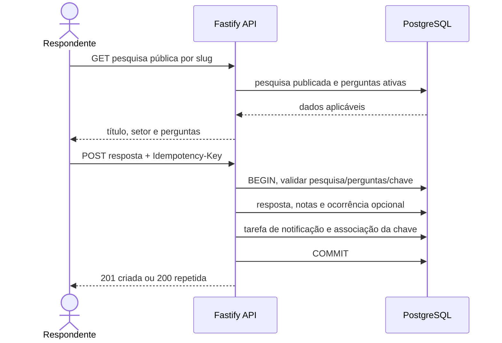

> Atualização de arquitetura em 26/11/2026: rotas, controllers, serviços e models foram separados; ver [relatório](REFACTOR-REPORT.md). Regras de negócio preservadas.

# Especificação de Requisitos de Software — API FHDOD

**Versão:** 1.0 · **Data:** 25/11/2026 · **Base de análise:** código e migrations presentes no repositório. Este documento usa a organização da IEEE 830 e características da ISO/IEC 25010 como referências; não declara conformidade formal com essas normas.

## 1. Identificação

| Campo | Informação |
|---|---|
| Projeto | API FHDOD — Pesquisa de Satisfação |
| Natureza | Backend REST para pesquisas, painel administrativo e indicadores |
| Repositório analisado | `backend-FHDOD`, branch `develop` no momento da análise |
| Frontend | Não incluído neste checkout; integração REST é citada na documentação existente |
| Persistência | PostgreSQL |

## 2. Introdução

### 2.1 Finalidade

Registrar requisitos que possam ser ligados a código ou esquema existente, delimitar o escopo comprovado e fornecer critérios verificáveis para avaliação e evolução. A especificação descreve a implementação observada, não substitui validação dos requisitos de negócio pela equipe.

### 2.2 Escopo

A API oferece rotas REST para autenticação, administração de usuários, setores e pesquisas, recebimento público de respostas, indicadores e gestão de ocorrências. O frontend não está incluído neste repositório. As URLs de implantação informadas pelo responsável são [frontend](https://fhdod.vercel.app/) e [API](https://backend-fhdod.onrender.com/); disponibilidade e configuração dos serviços não foram verificadas neste ambiente. O repositório também não contém worker de e-mail ou configuração de Kanban.

### 2.3 Público-alvo

Dupla responsável pelo projeto, docentes/avaliadores, mantenedores e consumidores técnicos da API.

### 2.4 Termos e abreviações

| Termo | Definição |
|---|---|
| API | Interface HTTP da aplicação |
| NPS | Nota de 0 a 10 classificada como detrator (0–6), passivo (7–8) ou promotor (9–10) |
| JWT | Token assinado utilizado como bearer na autenticação |
| Idempotência | Repetir uma submissão com a mesma chave na pesquisa não cria outra resposta |
| Ouvidoria | Papel `ombudsman`, com permissões globais em algumas operações |
| Gestor | Papel `sector_manager`, limitado aos setores associados |
| CA | Autoridade certificadora usada para validar TLS do PostgreSQL |

## 3. Visão geral

### 3.1 Contexto e problema

O backend fornece uma API central para capturar avaliações de atendimento e disponibilizar administração e indicadores por perfil. A necessidade de negócio detalhada, os canais de atendimento e os critérios institucionais de sucesso não estão identificados no repositório e devem ser confirmados com a equipe.

### 3.2 Objetivos observáveis

- Publicar pesquisa por setor e consultar pesquisa pública usando slug.
- Registrar respostas NPS e notas, opcionalmente com ocorrência.
- Restringir operações do painel por papel e associação a setor.
- Oferecer indicadores agregados e relatórios paginados.
- Validar a entrada, proteger rotas e manter persistência relacional.

### 3.3 Usuários/atores

| Ator | Capacidade observada |
|---|---|
| Respondente público | Consultar pesquisa publicada e submeter resposta; sem conta |
| Admin | Administrar contas e acessar funções globais autorizadas |
| Ouvidoria | Acessar funções globais de setores, pesquisas, perguntas, notificações, ocorrências e relatórios |
| Gestor de setor | Operar em setores atribuídos; não acessa listagem de reclamações nem relatório individual |
| Operador da implantação | Configurar processo, banco e migrations por ambiente; detalhes de equipe não identificados |

### 3.4 Restrições e dependências

- Node.js 22 ou superior, TypeScript, Fastify 5 e PostgreSQL.
- Configuração obrigatória validada por Zod na inicialização; banco acessado via `pg`.
- `DATABASE_URL`, segredos distintos com mínimo de 32 caracteres e, em produção, `DATABASE_CA_CERT(_PATH)` e `MIGRATION_DATABASE_URL`.
- CORS depende de origens configuradas; padrão local `http://localhost:3000`.
- Não há importação de dados/identidades do sistema legado identificada.
- Horários dos turnos são fixos em `America/Sao_Paulo`: manhã 07:00–12:00, tarde 12:00–19:00 e noite 19:00–07:00.
- `database/migrations/002_client_confirmed_requirements.sql` comenta que novas submissões devem exigir `attended_at`, mas o schema Zod atual torna `attendedAt` opcional e a documentação de API existente também o trata como opcional. Este documento registra o comportamento executável atual; a intenção de negócio precisa ser confirmada.

## 4. Requisitos funcionais

Os códigos abaixo identificam comportamento implementado. Pré-condições, fluxo e aceitação foram formulados a partir das rotas/serviços existentes.

### RF001 — Consultar estado da API

- **Descrição:** oferecer liveness e readiness.
- **Ator:** operador/monitor externo.
- **Pré-condição:** processo iniciado.
- **Fluxo principal:** cliente chama `GET /api/v1/health/live` ou `/ready`; live retorna `200 {status: ok}`, ready consulta PostgreSQL e retorna `200` ou `503` genérico.
- **Pós-condição:** nenhuma alteração de dados.
- **Aceitação:** live funciona sem depender de consulta ao banco; ready falha de forma controlada se o banco indisponível.

### RF002 — Autenticar e administrar sessão

- **Descrição:** login emite access e refresh JWT; refresh rotaciona sessão; logout revoga refresh; perfil autenticado pode trocar senha e consultar `/auth/me`.
- **Ator:** usuário cadastrado.
- **Pré-condição:** perfil ativo; credenciais válidas para login.
- **Fluxo principal:** `POST /auth/login`; usar bearer nas rotas protegidas; `POST /auth/refresh` para rotação ou `POST /auth/logout` para revogar; `PATCH /auth/password` confere senha atual e atualiza hash.
- **Pós-condição:** sessão registrada por JTI/hash; refresh anterior revogado; após troca, flag `must_change_password` limpa.
- **Aceitação:** credenciais inválidas retornam 401; refresh inválido/revogado não é aceito; nova senha tem 12–200 caracteres.

### RF003 — Administrar usuários

- **Descrição:** Admin lista usuários e cria usuário com senha temporária e papel, atribuindo setores a gestores.
- **Ator:** Admin.
- **Pré-condição:** bearer válido e senha provisória já trocada, quando obrigatório.
- **Fluxo principal:** `GET /users` ou `POST /users` com e-mail, nome, papel, senha temporária e IDs de setores aplicáveis.
- **Pós-condição:** perfil salvo com hash Argon2id; contas criadas pela rota precisam trocar senha; vínculos de setor persistidos.
- **Aceitação:** só Admin; gestor requer ao menos um setor ativo; outros papéis não podem receber setores nesta rota; nenhum hash é retornado.

### RF004 — Consultar pesquisas e setores públicos

- **Descrição:** listar setores ativos com pesquisa publicada e obter detalhes/perguntas ativas de uma pesquisa por slug.
- **Ator:** respondente público.
- **Pré-condição:** setor ativo e pesquisa publicada.
- **Fluxo principal:** `GET /sectors/public` e `GET /surveys/public/{slug}`.
- **Pós-condição:** somente leitura.
- **Aceitação:** slug inválido é rejeitado; pesquisa inexistente/inativa não é exposta; questões globais e do setor podem ser listadas.

### RF005 — Submeter resposta pública

- **Descrição:** persistir NPS, respostas de avaliação, data informada opcional e ocorrência consentida, usando chave de idempotência.
- **Ator:** respondente público.
- **Pré-condição:** pesquisa publicada, corpo válido, UUID `Idempotency-Key`.
- **Fluxo principal:** `POST /surveys/public/{slug}/responses`; valida perguntas ativas e aplicáveis; calcula turno; grava resposta, notas, ocorrência opcional, tarefa de notificação e chave em transação.
- **Pós-condição:** primeira submissão retorna 201; repetição da chave na mesma pesquisa retorna 200 com resposta original.
- **Aceitação:** NPS 0–10; notas 1–5; pergunta sem repetição e aplicável; contato exige consentimento; ocorrência só aceita se houver nota abaixo de 3; `attendedAt` é opcional.

### RF006 — Administrar setores

- **Descrição:** listar setores permitidos por papel e criar setor.
- **Ator:** usuário autenticado; criação para Admin/Ouvidoria.
- **Pré-condição:** bearer válido e troca de senha concluída.
- **Fluxo principal:** `GET /sectors` opcionalmente filtra por `sectorId`; `POST /sectors` recebe nome e slug.
- **Pós-condição:** setor criado ou lista retornada sem modificação.
- **Aceitação:** Admin/Ouvidoria veem todos; gestor somente os associados; acesso a ID não autorizado é recusado; slug segue formato minúsculo separado por hífens.

### RF007 — Publicar pesquisa

- **Descrição:** criar pesquisa publicada para setor, com título e intervalo de reinicialização do tablet.
- **Ator:** Admin, Ouvidoria ou gestor atribuído ao setor.
- **Pré-condição:** bearer válido e setor autorizado.
- **Fluxo principal:** `POST /surveys` com `sector_id`, `title`, `tablet_reset_seconds`.
- **Pós-condição:** pesquisa é gravada como `published` com `published_at` atual.
- **Aceitação:** título de 2–150 caracteres; intervalo 10–120 segundos; índice no banco restringe uma pesquisa publicada por setor.

### RF008 — Administrar perguntas de avaliação

- **Descrição:** listar perguntas ativas, criar pergunta rating opcional e desativar pergunta rating.
- **Ator:** Admin/Ouvidoria ou gestor com acesso ao setor.
- **Pré-condição:** autenticação e autorização necessárias; gestor só cria pergunta associada a setor seu.
- **Fluxo principal:** `GET/POST /questions`, `PATCH /questions/{id}` com `active:false`.
- **Pós-condição:** pergunta criada ou inativada logicamente.
- **Aceitação:** texto 3–300 caracteres; pergunta de criação é `rating` e `required=false`; questão global só é permitida a Admin/Ouvidoria.

### RF009 — Configurar notificações

- **Descrição:** ler ou substituir lista de destinatários e estado habilitado.
- **Ator:** Admin ou Ouvidoria.
- **Pré-condição:** bearer autorizado.
- **Fluxo principal:** `GET/PUT /settings/notifications`.
- **Pós-condição:** configuração singleton salva no banco.
- **Aceitação:** até 20 endereços válidos; estado é booleano. O envio de e-mail não está implementado.

### RF010 — Consultar indicadores

- **Descrição:** fornecer métricas agregadas para painel autorizado e rota pública de TV.
- **Ator:** painel autenticado (métricas delimitadas por setor); consumidor público (somente total agregado de TV).
- **Pré-condição:** painel autenticado para `/dashboard/metrics`; nenhuma autenticação para `/tv/metrics`.
- **Fluxo principal:** consulta opcional por setor, intervalo e turno no painel; rota TV retorna agregados gerais.
- **Pós-condição:** nenhuma alteração.
- **Aceitação:** gestor vê só setores atribuídos; filtro `from` inclusivo, `to` exclusivo; TV não inclui linhas, comentários ou contatos individuais.

### RF011 — Gerir ocorrências

- **Descrição:** listar reclamações/ocorrências paginadas e atualizar status.
- **Ator:** Admin ou Ouvidoria.
- **Pré-condição:** bearer autorizado; para atualização, ID existente.
- **Fluxo principal:** `GET /complaints` com filtros ou `PATCH /complaints/{id}` com status permitido.
- **Pós-condição:** status atualizado e timestamp de atualização persistido.
- **Aceitação:** filtros de status válidos; limite 1–100 e offset 0–100000; gestor recebe 403.

### RF012 — Consultar relatório individual paginado

- **Descrição:** retornar respostas, notas e detalhes de ocorrência, com filtros e paginação.
- **Ator:** Admin ou Ouvidoria.
- **Pré-condição:** bearer autorizado.
- **Fluxo principal:** `GET /reports/responses` com filtros opcionais.
- **Pós-condição:** nenhuma alteração.
- **Aceitação:** ordenação mais recente primeiro; paginação validada; comentários/contatos incluídos somente para papéis privilegiados. Exportação não é feita por esta rota.

## 5. Requisitos não funcionais

| Código | Qualidade e requisito | Evidência / critério verificável |
|---|---|---|
| RNF001 | Segurança: autenticação por bearer JWT e perfis separados | `src/infrastructure/auth.ts`, preHandlers em `src/middlewares/auth.ts`; respostas HTTP 401/403 |
| RNF002 | Segurança: segredos independentes, mínimo 32 caracteres; produção exige CA PostgreSQL e URL de migration | `src/config/index.ts`; inicialização inválida deve falhar antes de servir tráfego |
| RNF003 | Segurança: consultas SQL parametrizadas e hash Argon2id | SQL usa parâmetros `$n`; `auth.ts` usa Argon2id |
| RNF004 | Segurança: limitar volume/tamanho de entrada | Fastify bodyLimit 32 KiB; rate limits global, login e submissão; validações Zod |
| RNF005 | Privacidade: respostas de erro não expõem stack; logs ocultam authorization/cookie | Error handler em `src/middlewares/errors.ts`; logger com campos redacted |
| RNF006 | Confiabilidade: gravação de resposta/ocorrência/chave é transacional e repetição idempotente | `src/services/survey.ts`; chave única `(survey_id, submission_id)` |
| RNF007 | Integridade de dados: UUID, foreign keys, enums, checks e índices | `database/migrations/*.sql` |
| RNF008 | Manutenibilidade: TypeScript estrito e lint/typecheck/build disponíveis | `tsconfig.json`, scripts npm; comandos executáveis |
| RNF009 | Compatibilidade: plataforma Node 22+ e esquema OpenAPI 3.1 | `package.json`, `src/routes/`, `src/services/` |
| RNF010 | Desempenho: limites de pool/timeouts são configuráveis; não há SLO medido | `src/config/index.ts` e `database.ts`; metas de latência/carga: a confirmar |
| RNF011 | Usabilidade: documentação interativa local e health endpoints | `/api/docs`, `/api/v1/health/*`; textos e acessibilidade do frontend fora do escopo |
| RNF012 | Escalabilidade: aplicação HTTP sem estado de sessão em memória; sessões refresh persistem no banco | estado de refresh em `refresh_sessions`; capacidade/carga horizontal não foi medida |
| RNF013 | Confiabilidade de produção: TLS validado no PostgreSQL em modo produção | `src/config/postgres-ssl.ts`, validação de configuração |
| RNF014 | Cobertura automatizada: nenhuma meta nem ferramenta de cobertura configurada | Vitest disponível; cobertura percentual não identificada |

Não foi estabelecida meta numérica de disponibilidade, latência, concorrência, acessibilidade ou recuperação; definir com a equipe caso sejam critérios de avaliação.

## 6. Regras de negócio observadas

1. Uma pesquisa publicada por setor, garantida por índice único parcial.
2. Gestores precisam estar associados ao setor em `sector_managers`; o ID enviado não concede permissão.
3. Contas criadas pela rota de usuários devem trocar senha no primeiro acesso.
4. Ocorrência opcional só é válida se pelo menos uma nota for inferior a 3; informar contato requer consentimento.
5. Uma chave UUID de idempotência identifica no máximo uma submissão por pesquisa.
6. Turno é determinado em `America/Sao_Paulo`; hora da consulta é usada quando `attendedAt` ausente.
7. `from` inclui o instante inicial e `to` exclui o final.
8. A rota pública TV entrega agregados, sem dados individuais.
9. Só Admin cria usuário; algumas operações administrativas aceitam Admin/Ouvidoria.
10. Não foi identificado worker para processar `notification_jobs`.

## 7. Restrições técnicas

- API e banco são dependências obrigatórias; UI não faz parte do repositório.
- Sem envio de e-mail, exportação de arquivos ou migração de identidade/dados legados comprovados.
- `render.yaml` descreve a configuração da API no Render; as URLs públicas informadas são registradas neste documento e no README, sem afirmar disponibilidade operacional.
- Apenas migrations numeradas 001/002 são parte do esquema visível; compatibilidade com schema legado não comprovada.

## 8. Casos de uso / fluxos principais

Fluxo do painel: login → bearer → checagem de troca de senha → autorização por papel/setor → consulta/alteração parametrizada → resposta JSON com request ID em erros.

## 9. Matriz de rastreabilidade

| Código | Descrição | Funcionalidade | Localização | Evidência | Situação |
|---|---|---|---|---|---|
| RF001 | Saúde live/ready | Monitoramento | `src/routes/`, `src/services/` | Rotas `/health/*` | Implementado |
| RF002 | Login, sessão, senha e perfil | Autenticação | `src/routes/`, `src/services/`, `src/infrastructure/auth.ts` | Rotas `/auth/*`, `refresh_sessions` | Implementado |
| RF003 | Administração de contas | Usuários | `src/routes/`, `src/services/`, migration 001 | `/users`, `profiles`, `sector_managers` | Implementado |
| RF004 | Consulta pública de setor/pesquisa | Catálogo | `src/routes/`, `src/services/`, `src/services/survey.ts` | `/sectors/public`, `/surveys/public/:slug` | Implementado |
| RF005 | Submissão validada e idempotente | Respostas | `src/routes/`, `src/services/`, `src/services/survey.ts` | POST `/responses`, transação SQL | Implementado |
| RF006 | Listar/criar setores com autorização | Setores | `src/routes/`, `src/services/`, `src/services/access.ts` | `/sectors` | Implementado |
| RF007 | Publicar pesquisa | Pesquisas | `src/routes/`, `src/services/`, migration 001 | POST `/surveys`, índice parcial | Implementado |
| RF008 | Perguntas rating | Perguntas | `src/routes/`, `src/services/` | `/questions` | Implementado |
| RF009 | Configurar destinatários | Notificações | `src/routes/`, `src/services/`, `app_settings` | `/settings/notifications` | Parcial: configuração existe; envio não identificado |
| RF010 | Agregados do painel e TV | Indicadores | `src/routes/`, `src/services/`, `src/domain/metrics.ts` | `/dashboard/metrics`, `/tv/metrics` | Implementado |
| RF011 | Listar/atualizar ocorrência | Ouvidoria | `src/routes/`, `src/services/` | `/complaints` | Implementado |
| RF012 | Relatório paginado | Respostas | `src/routes/`, `src/services/` | `/reports/responses` | Implementado |
| Kanban | Acompanhar tarefas da dupla | Processo | Link a fornecer pela equipe | Nenhum board/link no checkout | A confirmar pela equipe |
| Notificações por e-mail | Entregar alertas | Worker externo | `notification_jobs` | Tabela existe; worker/provedor não encontrado | Não implementado neste repositório |

## 10. Pendências de validação com a equipe

Confirmar necessidade original e critérios de negócio; se `attendedAt` deve ser obrigatório (comentário da migration diverge do schema executável); horários dos turnos; políticas de retenção e privacidade; provedor/worker de notificações; comportamento do frontend; link e evidências do Kanban; integrantes e atribuições individuais; metas mensuráveis de desempenho/qualidade; estado de implantação e URL pública.
